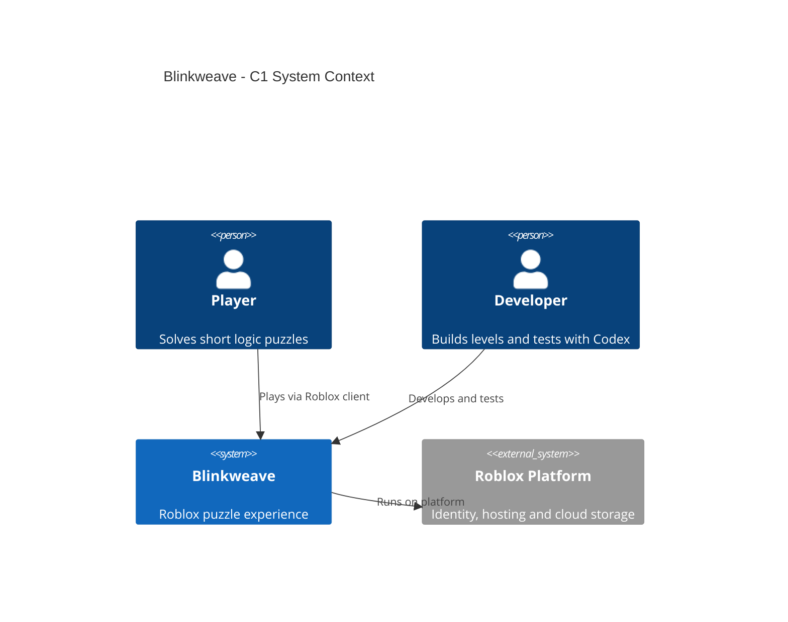
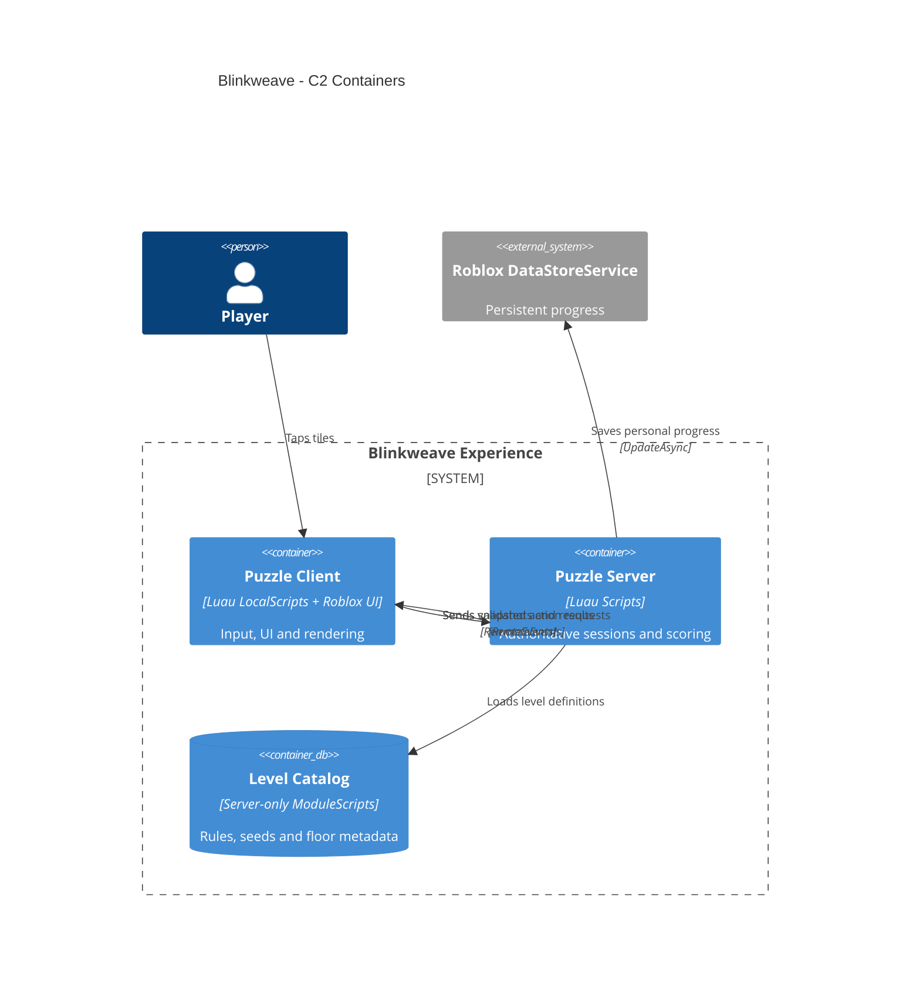
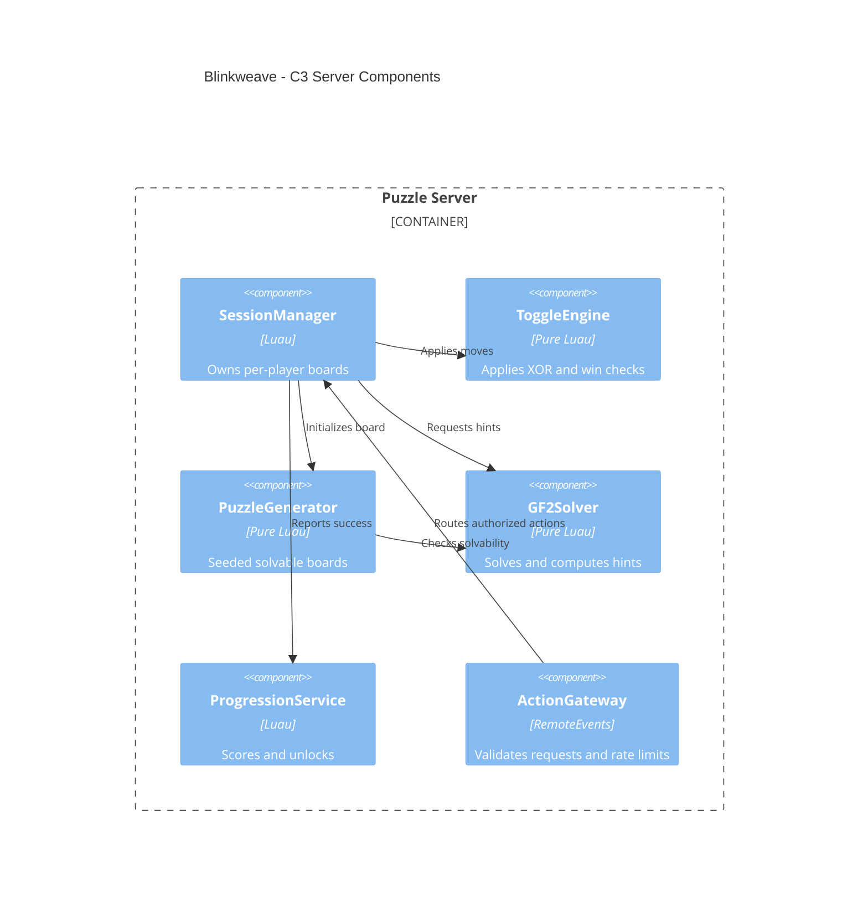

# Blinkweave

> **A pocket-sized light-switch puzzle tower for Roblox.** Flip one tile, change its neighbors, solve the pattern, climb the tower.

**Project:** Roblox experience / single repository  
**Status:** Pre-production specification — README only; game code is not implemented yet.  
**Working title:** `Blinkweave` (preliminary web name screening only; **not** legally trademark-cleared).  
**Inspiration:** The general *Lights Out* toggle-neighbor puzzle concept; **no** copied art, levels, branding, sounds, or source code.

## 1. Game concept

- **Players:** 1 per puzzle board; optional cooperative board for 2 players in v2.
- **Platform:** Roblox on mobile, desktop, and consoles; mobile-first interactions.
- **Format:** Short tower floors, each with one self-contained logic challenge.
- **Session target:** 2–8 minutes, with easy replay and no waiting for other players.
- **Unique angle:** A physical 3D board, progressively changing toggle patterns, immediate visual feedback, and verifiably solvable puzzles.

### Core gameplay loop

1. Enter the next floor and inspect a 3×3, 4×4, or 5×5 light grid.
2. Tap a tile; the tile and its orthogonal neighbors toggle between on/off.
3. Turn **every tile off** to unlock the exit.
4. Receive a score based on number of moves, optional hints, and completion time.
5. Replay for a better result or move up one floor.

### Exact rules (MVP)

| Rule | Definition |
|---|---|
| Grid | 3×3 tutorial; 4×4 and 5×5 later |
| Toggle | XOR the pressed tile plus its in-bounds N/E/S/W neighbors |
| Win | Every cell equals `false` |
| Input | Click/tap the tile or its matching accessible UI button |
| Reset | Restores the initial state of the **current** puzzle; no penalty in the tutorial |
| Undo | One-step undo of the last accepted move; configurable per level |
| Hint | Highlights one useful next move from a server-computed solution |
| Score | Stars based primarily on optimal moves; do not use time as the only metric |
| Failure | No death, damage, or unrecoverable puzzle state |

**Puzzle solvability:** Generate a board by starting from the all-off state and applying a seeded sequence of legal toggle operations. Reject the solved starting board. Validate the generated state with a GF(2) linear-system solver. A minimum-move solution can be computed by exploring the solver's free variables (small board sizes only), otherwise use a verified solution without calling it optimal.

**Difficulty:** Progress from cross-shaped toggles to new patterns (diagonals, row/column, blocked cells) **only after** the initial rules are understood. Each new rule gets its own tutorial and test suite. Do not silently change rules inside a floor.

## 2. MVP / non-goals

### MVP deliverables

- [ ] 3D lobby + 10 floors: 3 tutorial, 4 standard, 3 advanced.
- [ ] Single-player independent puzzle sessions within a shared Roblox server.
- [ ] Tap/click input, tile animations, audio cue, undo, restart, hint, floor exit.
- [ ] Deterministic seed-based boards and solver-validated level data.
- [ ] Saved highest unlocked floor, stars, and personal best per level.
- [ ] Responsive UI: safe areas, scalable fonts, clear tile states, keyboard + touch.
- [ ] Analytics: tutorial start/finish, floor start/finish, resets, hints, exits.
- [ ] Automated rule/solver tests and Roblox Studio smoke tests.

### Out of scope until player validation

Global leaderboards, user-generated puzzles, co-op, daily challenges, advertising, currencies, paid advantages, inventory system, and heavy 3D art.

## 3. Level representation

Use versioned, **data-driven** level definitions. Store authoritative level data in `ServerScriptService`; expose only the current visible board and allowed UI metadata to the client.

```luau
--!strict
export type Level = {
    id: string,
    width: number,
    height: number,
    rule: "cross" | "diagonal" | "row",
    seed: number,
    target: "allOff",
    parMoves: number?,
    allowUndo: boolean,
}

-- Example metadata; actual board is generated and validated server-side.
local intro01: Level = {
    id = "floor_001",
    width = 3,
    height = 3,
    rule = "cross",
    seed = 10427,
    target = "allOff",
    parMoves = nil, -- computed by solver, not guessed
    allowUndo = true,
}
return intro01
```

Define a **pure Luau** function `toggle(state, index, rule) -> newState`; never make Roblox `Part` instances the source of truth. A board revision increases after every server-accepted action. Server messages include `{sessionId, revision, cells, moves, solved}`. Use an action request such as `{sessionId, expectedRevision, cellIndex}`, not a client-supplied board state.

## 4. C4 architecture

### C1 — System context



### C2 — Containers (logical execution boundaries)



### C3 — Server components



C4 containers here mean runtime **responsibilities**, not Docker containers or independently deployed services. No custom backend, Kubernetes cluster, or database server is required.

## 5. Repository structure (target)

```text
blinkweave/
├── README.md
├── AGENTS.md                 # Codex instructions and acceptance criteria
├── rokit.toml                # pinned tools; create during bootstrap
├── default.project.json      # Rojo mapping
├── selene.toml
├── .stylua.toml
├── .luaurc
├── src/
│   ├── shared/              # typed requests, events and level types
│   ├── client/              # BoardController, InputController, HUD, VFX
│   └── server/              # ActionGateway, SessionManager, ProgressionService
│       ├── logic/           # ToggleEngine, GF2Solver, PuzzleGenerator
│       └── levels/          # data-only definitions
├── tests/                   # pure logic + server integration tests
├── scripts/                 # Lune test runner
└── .gitlab-ci.yml           # checks and Rojo build (to implement)
```

## 6. Tools and setup

**Verified stable tool baseline (2026-10-15).** Roblox Studio is continuously updated and does not publish a conventional long-term-support version. Pin external tools to released versions, update intentionally, and verify compatibility in Studio.

| Tool | Version / approach | Purpose |
|---|---|---|
| Roblox Studio | Current stable | Scene editing, device and multiplayer tests, publishing |
| Luau | Built into Studio, `--!strict` | Typed gameplay logic |
| VS Code + Codex CLI | Current supported release | AI-assisted development |
| Roblox Studio MCP | Built into Studio | Codex ↔ Studio edits, inspection and playtesting |
| Rokit | 1.2.0 | Toolchain manager |
| Rojo | 7.7.1 | Sync source files ↔ Roblox Studio |
| Lune | 0.11.0 | Headless tests of pure Luau modules |
| Selene | 0.32.0 | Lint |
| StyLua | 2.6.0 | Formatting |
| Wally | 0.3.2, optional | Third-party Luau packages; avoid unless needed |
| Git + GitLab CI | Existing installation | Source control and quality gates |

**Bootstrap a new, empty repository:**

1. Install **Roblox Studio**, **VS Code/Codex**, **Git**, and **Rokit** from their official release/documentation pages.
2. Run `rokit init`, then add the following pinned tools:

```powershell
rokit add rojo-rbx/rojo@7.7.1
rokit add lune-org/lune@0.11.0
rokit add Kampfkarren/selene@0.32.0
rokit add JohnnyMorganz/StyLua@2.6.0
# optional: rokit add UpliftGames/wally@0.3.2
rokit install
rojo init
rojo plugin install
```

3. Configure `default.project.json` to map `src/shared` to `ReplicatedStorage`, `src/server` to `ServerScriptService`, and `src/client` to `StarterPlayerScripts`. Ensure levels under `src/server/levels` do not replicate to clients.
4. Add `.luaurc`, `selene.toml`, `.stylua.toml` and the Lune test runner; then run `rojo serve` and connect the Rojo Studio plugin.
5. In Roblox Studio: **Assistant → MCP Servers → Enable Studio as an MCP server → Quick Connect: Codex CLI**.
6. Build and run automated checks once the files above have been generated:

```powershell
stylua --check src tests
selene src tests
lune run scripts/test.luau
rojo build default.project.json --output build/blinkweave.rbxlx
```

The commands under step 6 are **future acceptance commands**, not runnable from this README-only starter. The Codex bootstrap task below must create the referenced files first.

## 7. Security, persistence, analytics

- The server is authoritative for board cells, actions, scores, hints, and unlocks.
- On each remote request: check membership, board id, cell bounds, expected revision, cooldown, and per-player action rate.
- Never persist client-reported move counts or level completion.
- Persist progress using `DataStoreService` with guarded `UpdateAsync` and retry/backoff; retain unsaved progress locally during transient failures.
- Do not store personally identifiable information or add third-party tracking SDKs for the MVP.
- Measure first puzzle completion, hint frequency, floor abandonment, D1/D7 retention when available, and replay rate.
- Accessibility: color **plus** icon/pattern states, sound-off option, generous touch targets.

## 8. Test plan / definition of done

- [ ] Every toggle obeys self + valid orthogonal-neighbor rule; pressing the same cell twice restores the board.
- [ ] Generator creates ≥1,000 solvable puzzles across supported sizes and seeds.
- [ ] Solver reconstructs a solution; any displayed “minimum moves” claim is proven for that board.
- [ ] Out-of-bounds, duplicate, stale, and rapid-fire remote actions are rejected safely.
- [ ] Two concurrent players have independent boards and saved progress.
- [ ] Save/load survives reconnect; failed data-store requests do not break gameplay.
- [ ] Playable without keyboard or voice chat; test phone portrait/landscape and desktop.
- [ ] Rojo build, formatting, lint, and pure-rule test suite pass in CI.

## 9. Implementation sequence for Codex

1. Scaffold Rojo project, strict Luau configuration, lint/format, headless tests, GitLab CI and `AGENTS.md`.
2. Implement and unit-test `ToggleEngine` and level serializers.
3. Implement GF(2) solver, seeded generator, and solvability property tests.
4. Implement server session state + action validation + RemoteEvents.
5. Build one 3×3 playable floor in Roblox Studio; test through MCP.
6. Add the level catalogue, 3D floor navigation, UI, animations, sounds, persistence.
7. Complete 10 tested floors, accessibility checks and 2-client smoke test.

**Codex starter instruction:** “Read README.md in full. Implement only Phase 1: a Rojo project and a fully unit-tested, strict-Luau ToggleEngine for a 3×3 grid. Add a test runner and lint/format configuration. Do not add monetization, telemetry SDKs, external backends, or marketplace assets.”

## 10. IP and release notes

- `Blinkweave` is a working title only. No identical public web matches were found during an initial search on 2026-10-15; this does **not** establish trademark availability.
- Before public launch, check exact **and similar** names in Austrian see.ip, EUIPO/TMview, relevant international registers, Roblox search, and stores; review Nice classes relevant to games/software.
- Design original graphics, sounds, levels, logos and tutorials. Do not use “Lights Out” or third-party game names as your marketed product title.
- Choose a repository license deliberately. A public Git repository does not grant others permission to use proprietary game assets.

### Reference documentation

- Roblox MCP: https://create.roblox.com/docs/studio/mcp
- External tools / Rojo: https://create.roblox.com/docs/projects/external-tools
- Luau type checking: https://create.roblox.com/docs/luau/type-checking
- Roblox security: https://create.roblox.com/docs/scripting/security/client-server-boundary
- Roblox Data Stores: https://create.roblox.com/docs/cloud-services/data-stores
- Studio testing: https://create.roblox.com/docs/studio/testing-modes
- C4 syntax: https://mermaid.js.org/syntax/c4.html
- Austrian trademark search: https://seeip.patentamt.at/markesuche
- EUIPO / TMview: https://www.euipo.europa.eu/en/search-ip
